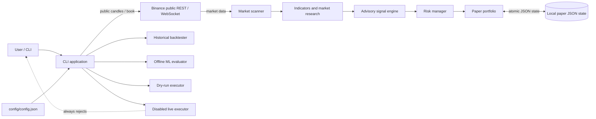
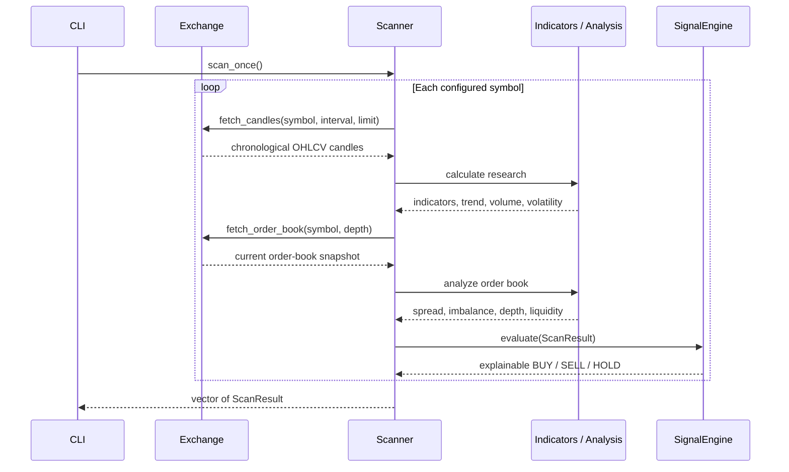

# Architecture Design

## Purpose and safety boundary

This C++20 application is a cryptocurrency market-research and simulation
project. It consumes public Binance market data, computes indicators and
advisory signals, evaluates risk, and can simulate paper fills or historical
backtests.

**It does not place exchange orders.** No exchange credentials or authenticated
trading API are implemented. The execution interface has a validated dry-run
adapter and a live adapter that always rejects submissions. Configuration
loading rejects `live_order_submission_enabled: true`.

## System context



Only the market-data adapters communicate with Binance. Paper fills, backtests,
and dry-run previews are local calculations; none call an order endpoint.

## Runtime components

| Component | Responsibility | Main location |
|---|---|---|
| Configuration and logging | Parse and validate endpoints, pairs, research, risk, paper, and execution settings; configure structured logging. | `include/common/`, `src/common/` |
| Exchange abstraction | Define public candle and order-book fetches; Binance implementation uses TLS-verified REST requests with configured timeouts. | `include/exchange/`, `src/exchange/` |
| Market stream | Consume public trade-price updates over TLS WebSocket with bounded operations. | `include/exchange/binance_market_stream.hpp`, `src/exchange/binance_market_stream.cpp` |
| Indicators | Calculate EMA, RSI, MACD, Bollinger Bands, ATR, and Stochastic RSI; reject invalid or unordered candles and report warm-up availability. | `include/indicators/`, `src/indicators/` |
| Market analysis | Derive trend, support/resistance, volume, volatility, and order-book measurements from candles and snapshots. | `include/market/`, `src/market/` |
| Scanner | Fetch configured markets, assemble `ScanResult` data, preserve per-market data errors, and evaluate advisory signals. | `include/market/market_scanner.hpp`, `src/market/market_scanner.cpp` |
| Signal engine | Combine weighted research with quality, coverage, confirmation, volatility, spread, and estimated-cost gates. Signals are not calibrated probabilities. | `include/ai/signal_engine.hpp`, `src/ai/signal_engine.cpp` |
| Risk manager | Assess buy-only spot intents against a caller-provided portfolio snapshot; size quantity, define ATR exits, and latch loss/drawdown shutdown. | `include/risk/risk_manager.hpp`, `src/risk/risk_manager.cpp` |
| Paper portfolio | Apply simulated fills to a local cash/position ledger, calculate account snapshots, and persist executions and risk-halt state. | `include/paper/paper_portfolio.hpp`, `src/paper/paper_portfolio.cpp` |
| Backtester | Simulate a single symbol over chronological candles with shared signals/risk logic and conservative order-cost assumptions. | `include/backtest/backtester.hpp`, `src/backtest/backtester.cpp` |
| ML evaluator | Fit a deterministic regularized logistic classifier and report chronological holdout metrics; isolated from trading decisions. | `include/ml/ml_evaluator.hpp`, `src/ml/ml_evaluator.cpp` |
| Execution boundary | Validate and label dry-run previews; live adapter returns rejection for every request. | `include/execution/order_executor.hpp`, `src/execution/order_executor.cpp` |
| CLI | Select market-data, scanner, paper, backtest, ML, and dry-run workflows; catches top-level errors and reports failure. | `src/main.cpp` |

## Data flows

### Market research and advisory signals



An order-book failure is recorded separately from candle research. When no
book is available, signal cost estimates use the configured maximum spread and
the missing research component reduces signal coverage. Individual symbol
failures do not abort the remaining scan.

### Paper simulation

1. The scanner produces completed-candle research and a signal for each symbol.
2. The paper portfolio marks existing positions from the newest available
   candle close and evaluates protective stop, target, or advisory sell exits.
3. Exit fills apply estimated slippage, spread, and fees, then update cash and
   realized P/L.
4. A buy signal for a symbol without an open position becomes a buy-only risk
   intent. The risk manager validates the portfolio snapshot and returns a
   size/stop/target plan or a rejection.
5. Approved buys are simulated at an estimated price; cash, position, and
   execution ledger are persisted locally.

The paper implementation uses simplified fills and does not model queue
position, partial fills, market impact, or exchange constraints. Stop and target
triggers are checked using scan candle closes in the paper portfolio. The
separate historical backtester checks candle high/low and resolves ambiguous
same-bar stop/target hits pessimistically (stop first).

### Backtesting and ML evaluation

- The backtester calculates each signal from bars available before the next
  simulated entry, enters at the next bar open, applies transaction-cost
  estimates, and reports return, drawdown, trade, and per-bar Sharpe metrics.
- The ML evaluator builds candle-only features, labels five-candle forward
  returns net of estimated costs, and uses a chronological train/holdout split
  with overlapping training labels purged. Standardization is fit only on the
  training subset. The model is ephemeral and does not influence signals or
  paper execution.

Both operations consume candle histories fetched by the CLI and do not write to
paper portfolio state.

## Configuration and persistence

`common::load_config` reads `config/config.json` and rejects invalid settings.
Configuration controls:

- Binance public REST/WebSocket endpoints and timeouts.
- Tracked symbols, candle interval, and history limit.
- Indicator/research and weighted-signal parameters.
- Risk limits, including trade risk, open positions, daily loss, drawdown,
  exposure, ATR exits, fees, and slippage.
- Paper starting balance and local `paper_state_path`.
- `live_order_submission_enabled`, which must be `false`.

Paper state is a versioned JSON document containing cash, initial balance,
daily baseline/date, peak equity, shutdown status, open positions, and execution
history. Writes use a temporary sibling file and atomic replacement where
supported; malformed or unsupported state fails closed rather than silently
resetting the account. The paper state is local application data, not an
exchange-reconciled source of truth.

The risk manager itself is stateless with respect to account balances: it
requires the caller to supply a current `PortfolioRiskSnapshot`. The paper
portfolio builds that snapshot from its ledger. Its emergency shutdown is
latched in the manager and mirrored in persisted paper state; resetting requires
the account to be within configured limits.

## CLI workflows

Run commands from the repository root. Unless supplied, the config path is
`config/config.json`.

| Command | Behavior |
|---|---|
| `--candles SYMBOL [config]` | Fetch and print public candles. |
| `--stream SYMBOL [config]` | Stream public trade-price updates. |
| `--scan-once [config]` / `--scan [config]` | Run one or repeated research scans. |
| `--paper-once [config]` / `--paper [config]` | Run one or repeated local paper simulations. |
| `--paper-status [config]` | Display persisted paper account state. |
| `--paper-reset [config]` | Refresh marks/exits and reset shutdown only if safe. |
| `--backtest SYMBOL [config]` | Run a single-symbol historical simulation. |
| `--ml-evaluate SYMBOL [config]` | Evaluate a model on a chronological holdout. |
| `--execution-status [config]` | Display the execution safety boundary. |
| `--execution-dry-run SYMBOL SIDE QUANTITY [config]` | Preview a notional using the latest fetched candle close; `SIDE` is `buy` or `sell`. |

The dry-run command is not an order, risk approval, or guaranteed current quote.
The `DisabledLiveOrderExecutor` is intentionally non-functional and rejects all
submissions.

## Build and verification

Requirements are C++20, CMake 3.24+, Visual Studio C++ Build Tools on Windows,
vcpkg dependencies, and network access to fetch the pinned CMake dependencies.
On the configured Windows environment:

```powershell
cmake --preset windows-vcpkg
cmake --build --preset windows-release
ctest --preset windows-release
```

The GoogleTest executable covers configuration validation, market research,
signals, risk, paper persistence/fills, backtesting, ML evaluation, and executor
safety. During development, it can also be run directly as
`.\build\Release\crypto_trader_tests.exe`.

## Known limitations

- No authenticated exchange operations, API credentials, or live order
  submission.
- Public-data availability and Binance rate/network limits affect scan and
  command execution.
- Paper portfolio marks and fills are estimates and are not reconciled against
  an exchange account.
- Backtests are limited by candle history, OHLCV resolution, spread assumptions,
  and their simplified fill model; historical results do not forecast returns.
- ML holdout metrics are sample-dependent and are not calibrated probabilities
  or evidence of expected profitability.
- No multi-symbol portfolio backtest, model persistence, dashboard, or
  production deployment/monitoring is included.
