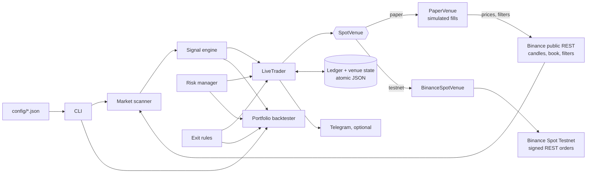
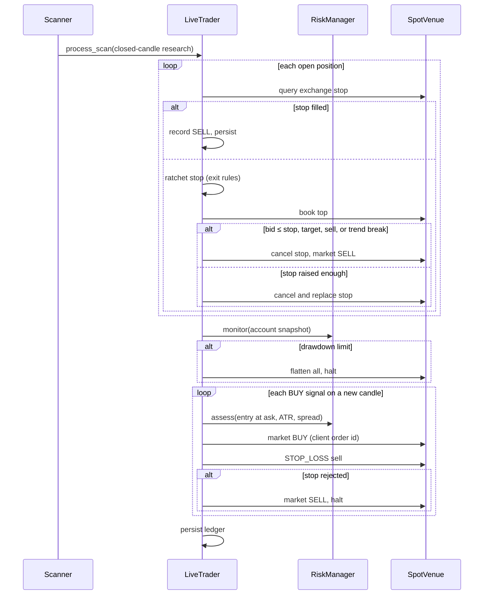

# Architecture Design

## Purpose and safety boundary

This C++20 application is an automated, long-only cryptocurrency trading bot
for Binance spot markets. It reads public market data, generates
trend-following signals, applies risk limits, and executes through one of two
venues:

- **Paper** — a simulated exchange priced from live public Binance data.
- **Testnet** — real orders on Binance Spot Testnet (no real money).

**Mainnet (real-money) orders are not enabled.** Configuration validation only
accepts `https://testnet.binance.vision` as the order endpoint, and testnet mode
requires both `mode: "testnet"` and `live_order_submission_enabled: true`. API
keys are read from `BINANCE_TESTNET_API_KEY` / `BINANCE_TESTNET_API_SECRET` and
are never written to configuration, state, or logs.

Paper and testnet run the **same** `LiveTrader` code path; only the venue
differs. The backtester uses the same signal engine, risk manager, and exit
rules on historical candles, trading every pair from one shared account.

## System context



## Capital protection

| Layer | Behaviour |
|---|---|
| Capital ring-fence | The bot trades only its own ledger, seeded with `live.capital_allocation` (paper: `paper_initial_balance`); other account funds are never used. Buys are limited to the smaller of that ledger and the exchange's free quote balance. |
| Order cap | No single entry exceeds `live.maximum_order_notional`, which must not exceed the allocation. |
| Per-trade risk | Each entry risks `risk.risk_per_trade_fraction` of the ledger (default 0.25%) between the fill price and the initial stop. |
| Exchange-resident stop | Every position gets a `STOP_LOSS` stop-market sell on the exchange immediately after the buy fills, so the loss stays bounded if the bot, PC, or network fails. Stop-market (not stop-limit) is used so a fast gap cannot skip the exit. |
| Never unprotected | If the stop cannot be placed or restored, the position is sold at market and trading halts. |
| Ratcheting | Break-even and trailing rules raise the stop; the exchange order is cancelled and replaced when the stop has risen by `live.stop_update_minimum_fraction`. |
| Bot-side backup exit | Each cycle the bot also sells at market if the best bid is at or below the ratcheted stop, at the take-profit, or on a sell/trend-break signal. |
| Daily pause | Losing `risk.daily_maximum_loss_fraction` (2%) in a UTC day blocks new entries until the next UTC day. Open positions keep their stops. |
| Drawdown kill switch | Falling `risk.maximum_drawdown_fraction` (10%) below peak equity halts trading permanently and, with `live.flatten_on_risk_shutdown`, sells every position. Only `--live-reset` / `--paper-reset` resumes, and only if limits are within bounds. `--live-flatten` triggers it manually. |
| Idempotent orders | Every order carries a persisted unique client order id. If a request times out or returns HTTP 5xx, the bot queries the order by that id instead of guessing; an unresolved buy halts trading. |
| Crash safety | State is written atomically after every order. Each cycle reconciles stops against the exchange (filled, cancelled, or missing stops are detected), and the last candle each pair was bought on is persisted so a restart never re-buys the same signal. |
| Unattended operation | `deploy/crypto-ai-trader.service` runs the bot as a systemd user service with automatic restart; optional Telegram alerts report every trade, halt, and error. |

No safeguard can guarantee against loss: stop-market orders can fill below the
stop in a gap, and the strategy loses money in choppy or bearish markets. These
layers bound the size of losses; they do not prevent them.

## Runtime components

| Component | Responsibility | Main location |
|---|---|---|
| Configuration, logging, alerts | Parse and validate all settings; console plus rotating log file; optional Telegram notifier. | `include/common/`, `src/common/` |
| Public market data | Closed-candle and order-book fetches over TLS; pages backwards for long histories; drops the still-forming candle so live research matches backtests. | `include/exchange/binance_exchange.hpp`, `src/exchange/binance_exchange.cpp` |
| Signed REST client | HMAC-SHA256 signing, server-clock sync, and classification of failures as definite rejections (`BinanceApiError`) or unknown outcomes (`BinanceUnknownOutcome`). Works public-only without keys. | `include/exchange/binance_signed_client.hpp`, `src/exchange/binance_signed_client.cpp` |
| Market stream | Public trade-price updates over TLS WebSocket (`--stream`). | `include/exchange/binance_market_stream.hpp`, `src/exchange/binance_market_stream.cpp` |
| Indicators and analysis | EMA, RSI, MACD, Bollinger, ATR, Stochastic RSI; trend, support/resistance and breakout, volume flow, volatility, order-book metrics. | `include/indicators/`, `include/market/`, `src/indicators/`, `src/market/` |
| Scanner | Fetches each pair, assembles `ScanResult`, evaluates signals, and in loop mode wakes at `scan_interval_seconds` or 3 s after each candle closes, whichever is sooner. | `include/market/market_scanner.hpp`, `src/market/market_scanner.cpp` |
| Signal engine | Weighted research with quality, coverage, confirmation, volatility, spread, and cost gates, plus the trend and breakout gates and the `exit_long` trend-break flag. Emits once per closed candle. | `include/ai/signal_engine.hpp`, `src/ai/signal_engine.cpp` |
| Risk manager | Sizes buy-only spot entries from an account snapshot; enforces position, exposure, daily-pause, and drawdown limits. | `include/risk/risk_manager.hpp`, `src/risk/risk_manager.cpp` |
| Exit rules | Ratchets the protective stop (break-even, chandelier trail). Shared by backtester and trader. | `include/risk/exit_rules.hpp`, `src/risk/exit_rules.cpp` |
| Spot venue | `SpotVenue` interface: symbol filters, book top, balances, market orders, exchange stop-market orders, query, cancel. | `include/execution/spot_venue.hpp` |
| Binance venue | `SpotVenue` over the signed client with client-order-id reconciliation and commission lookup. | `src/execution/binance_spot_venue.cpp` |
| Paper venue | Simulated `SpotVenue`: prices and filters from public Binance data; persisted balances and resting stops; stops trigger when the bid crosses them. | `include/execution/paper_venue.hpp`, `src/execution/paper_venue.cpp` |
| Live trader | The trading engine: manages positions (stop reconciliation, ratcheting, exits), applies risk limits, opens protected positions, and persists its ledger after each order. | `include/live/live_trader.hpp`, `src/live/live_trader.cpp` |
| Portfolio backtester | Replays all pairs on a common timeline from one shared account with the same signal, risk, and exit rules and conservative fills. | `include/backtest/backtester.hpp`, `src/backtest/backtester.cpp` |
| ML evaluator | Offline regularized logistic classifier with chronological holdout metrics; not used for trading. | `include/ml/ml_evaluator.hpp`, `src/ml/ml_evaluator.cpp` |
| Dry-run executor | Validated order preview (`--execution-dry-run`); sends nothing. | `include/execution/order_executor.hpp`, `src/execution/order_executor.cpp` |
| CLI | Command dispatch, plain-language market summary, account display. | `src/main.cpp` |

## Trading strategy

The default configuration is a long-only, 4h **trend-following breakout**
("trade with the flow") strategy.

| Stage | Rule | Setting |
|---|---|---|
| Regime | EMA 20 > EMA 50 > EMA 200 and close above EMA 20. | `signals.require_bullish_trend_for_buy` |
| Trigger | Close breaks above the prior 50-bar high (Donchian breakout). | `signals.require_breakout_for_buy`, `research.support_resistance_period` |
| Confirmation | Weighted momentum, candle-flow, and order-book score with quality, liquidity, spread, and cost gates. | `signals.*` |
| Sizing | Risk 0.25% of equity between entry and the initial stop, capped by cash, exposure, order cap, and 3 open positions. | `risk.risk_per_trade_fraction`, `risk.maximum_open_positions` |
| Initial stop | Entry − 2 ATR, resting on the exchange. | `risk.stop_atr_multiple` |
| Break-even | Stop moves to entry + round-trip costs once the highest close is 1.5R above entry. | `risk.breakeven_trigger_r` |
| Trailing stop | Highest close since entry − 4 ATR; never moves down. | `risk.trailing_stop_atr_multiple` |
| Take-profit | Entry + 10 ATR, so winners are rarely capped early. | `risk.target_atr_multiple` |
| Trend break | EMA 20 below EMA 50 with close below EMA 50 sells, even when entry gates (e.g. high volatility) block new signals. | `TradingSignal::exit_long` |

### Backtest evidence

Portfolio backtest (`--backtest-all`): BTC, ETH, SOL, BNB, XRP on 4h candles,
Nov 2023 – Nov 2026, one shared account, 0.1% taker fee, 0.05% slippage, 0.02%
spread on every fill, stop-first when a bar touches both stop and target.

| Risk per trade | 3-year return | Equal-weight buy-and-hold | Max drawdown | Worst day | Held-out bear year (Nov 2025 – Nov 2026) | Kill switch |
|---|---|---|---|---|---|---|
| **0.25% (default)** | **+17.7%** | +98% | **8.1%** | −1.5% | **−4.3%** (buy-and-hold −34.5%) | not triggered |
| 0.5% | +38.6% | +98% | 10.5% | −3.0% | −9.5% | triggered in 2026 |
| 1% | +36.5% | +98% | 10.1% | −3.1% | −8.9% | triggered early |

Yearly at 0.25%: 2023 (Nov–Dec) +2.2%, 2024 +11.6%, 2025 +7.8%, 2026 −4.3%.
At 0.5% with doubled fees and 5× spread the strategy still returned +28.7%
(profit factor 1.49).

Findings that shaped the design:

- The original 1m weighted-score strategy lost −5.5% in the development period
  with realistic costs (profit factor 0.58); 1m moves are smaller than fees.
- Single-symbol backtests understated risk: trading five correlated pairs from
  one account roughly doubled the worst drawdown. Portfolio backtesting is now
  the default.
- A daily-loss limit that latched permanently stopped the bot for over a year
  after one bad day; it now pauses until the next UTC day.
- The strategy does not beat buy-and-hold in bull markets. Its value is bounded
  drawdowns and staying mostly in cash during downtrends. The Nov 2025 – Nov
  2026 period has been inspected, so further tuning needs new data or
  walk-forward validation. Historical results do not forecast future returns.

## Trading cycle



Signals come from mainnet public data in both paper and testnet mode; testnet
prices closely track mainnet. A cycle that throws (for example a network
failure) is logged, alerted, and retried on the next wake-up while exchange
stops keep positions protected.

## Configuration and persistence

| File | Purpose |
|---|---|
| `config/config.json` | Paper mode (default). |
| `config/testnet.json` | Testnet mode: `mode: "testnet"`, `live_order_submission_enabled: true`, and the `live` section. |

Optional sections and keys default to backward-compatible values:
`signals.require_bullish_trend_for_buy`, `require_breakout_for_buy`,
`suppress_repeated_direction`; `risk.trailing_stop_atr_multiple`,
`breakeven_trigger_r`; `backtest.candle_count`, `spread_fraction`; `live.*`;
`log_file`.

| State | Contents |
|---|---|
| `paper_state_path` / `live.state_path` | Trader ledger: cash, allocation, daily baseline, peak equity, halt flag, positions with initial/ratcheted/exchange stop and stop order id, execution history, last entry candle per pair. |
| `<paper_state_path>.venue.json` (paper only) | Simulated exchange balances and orders. |
| `log_file` | Rotating log (5 MB × 3) of market decisions, trades, and errors. |

All state is written to a temporary sibling and atomically renamed. Malformed or
unsupported state fails closed instead of resetting the account.

## CLI workflows

Run from the repository root; the config path defaults to `config/config.json`.

| Command | Behaviour |
|---|---|
| `--paper [config]` / `--paper-once [config]` | Run the trader continuously / once against the simulated venue. |
| `--paper-status`, `--paper-flatten`, `--paper-reset [config]` | Show the ledger; sell everything and halt; resume after a halt if limits allow. |
| `--live [config]` / `--live-once [config]` | Same, against Binance Spot Testnet (testnet config and API keys required). |
| `--live-status`, `--live-flatten`, `--live-reset [config]` | Testnet equivalents. |
| `--backtest-all [config]` | Shared-account portfolio backtest of every configured pair. |
| `--backtest SYMBOL [config]` | Single-pair backtest with the trade list. |
| `--scan-once` / `--scan [config]` | Detailed research output without trading. |
| `--candles SYMBOL`, `--stream SYMBOL` | Print public candles / stream trade prices. |
| `--ml-evaluate SYMBOL` | Offline ML holdout evaluation. |
| `--execution-status`, `--execution-dry-run SYMBOL SIDE QTY` | Show the execution boundary; preview an order without sending it. |

## Build and verification

```bash
cmake --preset linux-release && cmake --build --preset linux-release && ctest --preset linux-release
```

```powershell
cmake --preset windows-vcpkg
cmake --build --preset windows-release
ctest --preset windows-release
```

The GoogleTest suite covers configuration validation, market research, signals,
risk (including the daily pause), exit rules, the portfolio backtester, the
live trader against a fake venue (protection, ratcheting, rejected stops,
flatten, restart safety, capital caps), the paper venue, HMAC signing against
Binance's documented vector, ML evaluation, and the dry-run executor.

## Known limitations

- Order execution is testnet-only; mainnet order submission is rejected by
  configuration validation.
- Commissions paid in BNB are not deducted from the bot ledger.
- A crash between a buy fill and the following state write (milliseconds) would
  leave an untracked exchange position; check the testnet account after any
  crash during an entry.
- Paper stops trigger only when a cycle observes the bid below the stop, so
  paper fills are checked at the scan cadence rather than tick by tick.
- Backtests use OHLCV bars: trailing stops ratchet on closed-bar closes and
  trigger on bar lows; historical order books are unavailable, so a fixed
  spread is assumed.
- Strategy parameters were selected on Nov 2023 – Nov 2026 data, which is no
  longer an untouched holdout.
